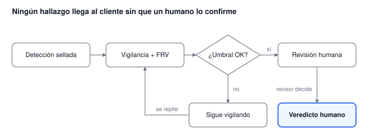

# BCSentinel AI — Caso de estudio técnico

5 nov 2026 · preparado por Ivan Alonso, fundador de BCSentinel AI (EMERGE) · [LinkedIn](https://www.linkedin.com/in/ivanalonsodev) · [X](https://x.com/ivanalonsodev)

BCSentinel AI es un sistema de inteligencia temprana sobre protocolos blockchain: detecta cuando un equipo está formando un nuevo proyecto on-chain antes de que eso sea de conocimiento público, verifica con evidencia on-chain si esa relación entre wallets es real y no una coincidencia, y vigila de forma continua hasta que la formación se vuelve verificable públicamente — dando a quien lo usa una ventana de tiempo real para decidir con ventaja. Todo el ciclo corre de forma automática, con un único punto de control deliberadamente no automatizable: la confirmación final siempre la da una persona.

## El problema

Cuando un equipo nuevo empieza a coordinarse on-chain —varias wallets que empiezan a moverse juntas, financiarse desde el mismo origen o compartir infraestructura— esa coordinación deja rastro mucho antes de que el proyecto anuncie nada públicamente: antes de una ronda de financiación, antes de un lanzamiento, antes de que el equipo se identifique. Ese margen de tiempo, medido sobre casos reales ya confirmados, tiene una mediana de 23 días entre la detección y el momento en que la información se vuelve pública — suficiente para que alguien que necesita actuar (análisis competitivo, asignación de capital, debida diligencia) lo haga con ventaja real en vez de reaccionar después del hecho.

## Arquitectura del sistema

El sistema encadena cinco etapas, todas automatizadas de forma recurrente, sin intervención manual en el día a día. Deliberadamente, esta sección describe el qué y el por qué de cada etapa, nunca el cómo exacto (algoritmos, umbrales, fuentes de datos concretas) — ese detalle es el producto.

*Pipeline de 5 etapas, 1 punto de decisión humana obligatoria*

La única rama que no vuelve a la vigilancia automática es la de revisión humana: incluso con el umbral cumplido, el sistema nunca cierra el caso por su cuenta.

## Decisiones de diseño

- **La confirmación final nunca es automática.** Ninguna combinación de evidencia, por fuerte que sea, cierra un caso por sí sola — está impuesto como invariante en el propio código, no solo como política: una persona identificada tiene que firmar la decisión antes de que un hallazgo llegue a considerarse confirmado.
- **La evidencia se gradúa por confianza, nunca se trata toda igual.** Una fuente débil por sí sola nunca dispara una alerta fuerte; para escalar hace falta o una fuente de mayor confianza, o dos tipos de evidencia independientes sobre el mismo caso — una regla explícita contra falsos positivos por coincidencia.
- **La verificación on-chain de relaciones es refuerzo, nunca evidencia pública independiente.** Confirmar que dos wallets están relacionadas on-chain aumenta la confianza en una señal ya vista, pero nunca sustituye a la evidencia pública real — evita razonar en círculo.
- **La integridad se puede probar externamente, sin pedirle a nadie que confíe en nuestra palabra.** Cada hallazgo se sella criptográficamente en el momento en que se detecta, encadenado con los anteriores, y ese estado se ancla periódicamente en un registro público externo — sin revelar nunca qué caso o qué wallet hay detrás, solo que la cadena de evidencia no se ha alterado.
- **Ingeniería defensiva como norma, no como excepción.** Copia de seguridad antes de cualquier escritura destructiva, procesamiento por lotes con límites explícitos para controlar coste y riesgo, y degradación controlada (un fallo aislado no bloquea el resto) en cada automatización recurrente.

## Resultados reales

De 196 casos reales auditados en el historial de etiquetado de BCSentinel, 142 son formaciones institucionales reales confirmadas. De esas, 57 tienen registradas tanto la fecha de primera señal como la fecha de visibilidad pública — lo necesario para medir la ventaja de forma honesta. 43 de esas 57 se detectaron antes de que la formación fuera pública (ventaja real); las otras 14 se identificaron correctamente como formaciones reales, pero solo después de ser ya públicas — un patrón documentado y esperado (una wallet operadora de una entidad ya pública, no una señal de fundación — ver `HISTORICAL_VALIDATION.md` para el caso concreto). Solo las 43 detecciones tempranas reales alimentan la siguiente tabla; sin nombres de cliente, wallet ni caso — solo la distribución agregada:

| Métrica (días de ventaja) | Valor |
| --- | --- |
| Mediana | 23 |
| Percentil 25 | 1 |
| Percentil 75 | 208,5 |
| Mínimo | 0 |
| Máximo | 1.651 |

La **media** es de unos **178 días** porque un pequeño número de casos detectados muy pronto (hasta 1.651 días antes) tira de ella hacia arriba; la **mediana, 23 días**, es la ventaja típica de un caso. Por eso aquí se muestra la distribución completa y no una sola cifra.

Ejemplos con nombre, verificables de forma independiente — Rarible (648 días), Across Protocol (496 días), Synthetix (276 días), Keep3r Network (281 días), Morpho (109 días) — además de casos donde la misma metodología detectó fraude antes de que fuera de conocimiento público, están en [HISTORICAL_VALIDATION.md](HISTORICAL_VALIDATION.md), con la metodología completa y reproducible.

Los casos se agrupan en tres patrones distintos de velocidad, cada uno con una implicación operativa distinta para quién recibe la alerta:

| Patrón | Criterio | Implicación |
| --- | --- | --- |
| Gradual | Más de 15 días de ventaja | Tiempo cómodo para analizar antes de decidir |
| Comprimido | Entre 3 y 15 días | Hay que decidir rápido, pero hay margen |
| En lote | 3 días o menos (incluye casos del mismo día) | La alerta y el evento público casi coinciden — valor está en saberlo, no en el tiempo de reacción |

## Retos técnicos resueltos

**Bug de datos silencioso, detectado auditando el propio resultado, no asumiéndolo correcto.** Una misma dirección guardada dos veces (con y sin un prefijo estándar) hacía que el sistema comparara, en un caso, una wallet contra sí misma y lo marcara como «relación confirmada» — un falso positivo por error de datos, no por evidencia real. Se encontró revisando a mano los resultados de una corrida antes de darlos por buenos, se corrigió la causa raíz (normalización de direcciones) y se limpiaron a mano, con copia de seguridad, las entradas ya contaminadas.

**Dependencias externas frágiles, aisladas para que un fallo no tumbe el resto.** Una API externa de datos on-chain supera ocasionalmente su tiempo de espera en la consulta más pesada; el diseño aisla cada elemento del lote, así que un fallo puntual se reintenta solo en la siguiente corrida programada, sin bloquear el resto del trabajo.

**Diagnóstico de permisos sin asumir lo obvio.** Una API pública devolvía error «404 no encontrado» al publicar, que parecía un problema de configuración o de nombre de recurso — la causa real era un token de acceso con permisos insuficientes (algunas APIs devuelven 404 en vez de 403 para no confirmar la existencia de un recurso a quien no tiene permiso). Se resolvió ampliando el permiso del token existente, sin rotar ni exponer ningún secreto.

**Una limitación real, documentada en vez de maquillada.** El sellado criptográfico solo se dispara la primera vez que un caso se registra en el sistema; los casos que ya existían antes de conectar ese mecanismo no se pueden sellar retroactivamente sin destruir su historial real de seguimiento. En vez de ocultar ese hueco o forzar un parche arriesgado, quedó documentado tal cual, con la decisión explícita de asumirlo en vez de arreglarlo con prisa.

## Qué queda fuera de este documento, y por qué

Fuera de este documento, a propósito: el código fuente completo, los umbrales y fórmulas exactas que gradan la fuerza de la evidencia, las fuentes y consultas de datos concretas que usa el sistema, y cualquier dato real de clientes (casos, wallets, empresas investigadas). Es el mismo criterio que aplica el propio sistema en su prueba de integridad pública —nunca revela qué caso o wallet hay detrás de un sello, solo que no se ha alterado— y refleja algo simple: ese detalle es el producto que se va a comercializar, no el portfolio que lo demuestra.
