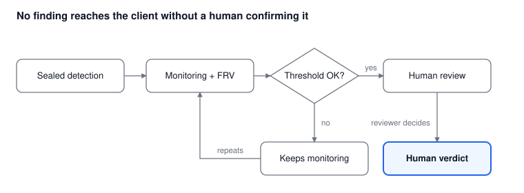

# BCSentinel AI — Technical Case Study

Nov 5, 2026 · prepared by Ivan Alonso, founder of BCSentinel AI (EMERGE) · [LinkedIn](https://www.linkedin.com/in/ivanalonsodev) · [X](https://x.com/ivanalonsodev)

BCSentinel AI is an early-intelligence system for blockchain protocols: it detects when a team is forming a new on-chain project before that becomes public knowledge, verifies with on-chain evidence whether the relationship between wallets is real and not a coincidence, and keeps monitoring continuously until the formation becomes publicly verifiable — giving whoever uses it a real window of time to decide with an advantage. The entire cycle runs automatically, with a single, deliberately non-automatable checkpoint: the final confirmation is always given by a person.

## The problem

When a new team starts coordinating on-chain — several wallets that start moving together, funding from the same source, or sharing infrastructure — that coordination leaves a trace long before the project announces anything publicly: before a funding round, before a launch, before the team identifies itself. That window of time, measured across already-confirmed real cases, has a median of 98.5 days between detection and the moment the information becomes public — enough for someone who needs to act (competitive analysis, capital allocation, due diligence) to do so with a real advantage instead of reacting after the fact.

## System architecture

The system chains five stages, all automated on a recurring basis, with no manual intervention in day-to-day operation. This section deliberately describes the what and the why of each stage, never the exact how (algorithms, thresholds, specific data sources) — that detail is the product.

*5-stage pipeline, 1 mandatory human decision point*

The only branch that does not return to automatic monitoring is human review: even once the threshold is met, the system never closes the case on its own.

## Design decisions

- **Final confirmation is never automatic.** No combination of evidence, however strong, closes a case by itself — this is enforced as an invariant in the code itself, not just as policy: an identified person has to sign off on the decision before a finding can be considered confirmed.
- **Evidence is graded by confidence, never treated equally.** A weak source on its own never triggers a strong alert; escalating requires either a higher-confidence source or two independent types of evidence on the same case — an explicit rule against false positives from coincidence.
- **On-chain verification of relationships reinforces, it never stands in as independent public evidence.** Confirming that two wallets are related on-chain increases confidence in a signal already observed, but it never substitutes for real public evidence — this avoids circular reasoning.
- **Integrity can be proven externally, without asking anyone to take our word for it.** Every finding is cryptographically sealed the moment it is detected, chained to the previous ones, and that state is periodically anchored in an external public record — never revealing which case or which wallet is behind it, only that the chain of evidence has not been altered.
- **Defensive engineering as the norm, not the exception.** Backup before any destructive write, batch processing with explicit limits to control cost and risk, and controlled degradation (an isolated failure does not block the rest) in every recurring automation.

## Real results

BCSentinel's historical library holds 187 addresses audited one by one (185 real investigated cases, plus 2 empty entries from the master key file itself, documented here for transparency). Of the 185, 50 meet the strict bar for measuring real lead time — an exact first on-chain signal date (T1) and an exact public-visibility date (T3), both backed by a verifiable public source: 35 institutional formations and 15 risk events (security incidents, irregular exits). Of those 50, 38 were detected a day or more in advance (true early warning); the other 12 were detected the same day or after the fact was already public — a documented and expected pattern (an operator wallet for an already-public entity, not a founding signal — see `HISTORICAL_VALIDATION.md` for the specific case). Only those 38 feed the table below; no client names, wallets, or case identifiers are shown, only the aggregate distribution:

| Metric (days of lead time) | Value |
| --- | --- |
| Median | 98.5 |
| 25th percentile | 23.3 |
| 75th percentile | 400.3 |
| Minimum | 1 |
| Maximum | 1,651 |

The **mean** is around **285 days** because a small number of very-early-detected cases (up to 1,651 days ahead) pull it upward; the **median, 98.5 days**, is the typical lead time for a case. That's why the full distribution is shown here rather than a single number. Split by type: the median is 98 days for formations (27 of 35 detected early) and 209 days for risk events (11 of 15 detected early).

Named, independently checkable examples of this lead time — ENS (1,651 days), Safe (826 days), Rarible (646 days), Across Protocol (496 days), Keep3r Network (281 days) — plus cases where the same methodology caught risk before it became public knowledge (for example, Multichain, 843 days ahead of its exploit), are in [HISTORICAL_VALIDATION.md](HISTORICAL_VALIDATION.md), with the full reproducible methodology.

Cases cluster into three distinct speed patterns, each with a different operational implication for whoever receives the alert:

| Pattern | Criterion | Implication |
| --- | --- | --- |
| Gradual | More than 15 days of lead time | Comfortable time to analyze before deciding |
| Compressed | Between 3 and 15 days | Need to decide quickly, but there's still margin |
| Same-batch | 3 days or less (includes same-day cases) | The alert and the public event almost coincide — the value is in knowing, not in reaction time |

## Technical challenges solved

**A silent data bug, caught by auditing the output itself rather than assuming it was correct.** The same address stored twice (with and without a standard prefix) caused the system, in one case, to compare a wallet against itself and flag it as a "confirmed relationship" — a false positive from a data error, not from real evidence. It was found by manually reviewing a run's results before accepting them, the root cause was fixed (address normalization), and the already-contaminated entries were cleaned up by hand, with a backup taken first.

**Fragile external dependencies, isolated so one failure doesn't take down the rest.** An external on-chain data API occasionally times out on the heaviest query; the design isolates each item in the batch, so a one-off failure is simply retried on the next scheduled run, without blocking the rest of the work.

**Permissions diagnosis without assuming the obvious.** A public API returned a "404 not found" error when publishing, which looked like a configuration or resource-naming problem — the real cause was an access token with insufficient permissions (some APIs return 404 instead of 403 so as not to confirm a resource's existence to someone without access). It was resolved by expanding the existing token's permissions, without rotating or exposing any secret.

**A real limitation, documented instead of glossed over.** Cryptographic sealing only triggers the first time a case is registered in the system; cases that already existed before that mechanism was connected cannot be sealed retroactively without destroying their real tracking history. Instead of hiding that gap or forcing a risky patch, it was documented as-is, with the explicit decision to accept it rather than rush a fix.

## What's left out of this document, and why

Deliberately left out of this document: the complete source code, the exact thresholds and formulas that grade the strength of evidence, the specific data sources and queries the system uses, and any real client data (cases, wallets, companies investigated). This is the same standard the system itself applies in its public integrity proof — it never reveals which case or wallet is behind a seal, only that it hasn't been altered — and it reflects something simple: that detail is the product being sold, not the portfolio that demonstrates it.
